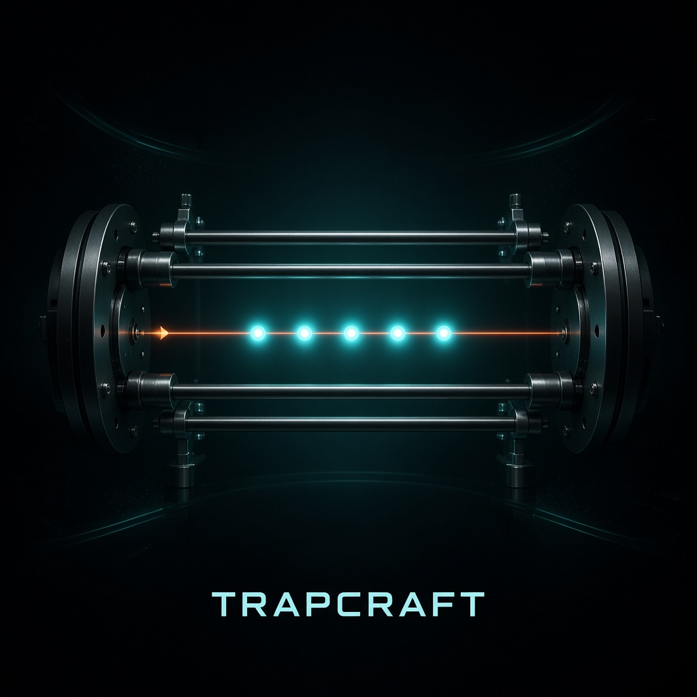

# TrapCraft



**Interactive trapped-ion laboratory for the Qollab × IonQ Global Quantum Hackathon.**

TrapCraft demystifies how IonQ-style quantum computers work in the physical world: RF Paul traps, laser-addressed **¹⁷¹Yb⁺** ions, and entanglement mediated by shared **phonon** motion — not abstract wires.

Track: **Quantum Unlocked (Education & Tools)** · Team: **TrapCraft** (solo) · License: **MIT**

## One-line pitch

A browser Paul-trap sandbox where learners fire IonQ-native **GPI / GPI2 / MS** pulses (angles in **turns**), watch the phonon bus carry entanglement, complete three guided missions, and export real Qiskit code.

## Why this exists

Most tutorials treat qubits as math on a blackboard, or only show superconducting chips. Builders rarely see:

1. How an RF quadrupole holds a Coulomb crystal of ions in vacuum  
2. How Raman lasers address individual atomic transitions  
3. How the **Mølmer–Sørensen** gate uses collective motion so *any* pair can entangle — no SWAP chain  

## What runs on Qollab

This repo is a **JS / Qiskit** project (`index.html` + `main.js` + `main.css` at the top level).

| Layer | Role |
| --- | --- |
| `js/ionPhysics.js` | Real Coulomb + harmonic **equilibrium** positions; COM & stretch mode shapes |
| `js/trapViewport.js` | three.js Paul-trap viewport, laser targeting, phonon animation |
| `quantum/gates.py` | Exact IonQ-published **GPI / GPI2 / MS** unitaries (turns) |
| `quantum/missions.py` | Three missions checked with Qiskit **Statevector** (no fake scores) |
| `quantum/run_demo.py` | **One** `backend.run` measuring the Mission 3 GHZ demo (IonQ one-job rule) |
| `js/export.js` | Copy-paste Python for `qiskit` / `qiskit-ionq` |

### Missions

1. **First Pulse** — `GPI2(0)` on ion 0 → equal superposition  
2. **Acoustic Link** — fully entangling `MS` on ions **1** and **4** (non-neighbors)  
3. **GHZ Crystal** — native H + MS-based CNOTs → \((|000\rangle+|111\rangle)/\sqrt{2}\) on ions 0–2  

Interactive **Check mission** uses exact Statevector math and does **not** consume the IonQ job.  
Pressing **Run** on Qollab submits **exactly one** circuit job (Mission 3 demo + printed solution checks).

## How to run on Qollab

**Live project:** [TrapCraft: Trapped-Ion Laser Lab](https://qollab.xyz/u/emarc/trapcraft-trapped-ion-laser-la)

1. Open the link → **Run on Qollab** (or Code → **Run Project** → **Run**).  
2. In **Select QPU**, pick a free simulator:
   - **Built-in simulator (24q)** — Ideal, Free  
   - or **IonQ Aria 1 (25q)** — Noise model, Free  
3. Press **Run**. TrapCraft performs **exactly one** `backend.run` (IonQ one-job rule).

**After Run you should see** the lab UI above the console, native-gate checks, three mission **PASS** lines, and GHZ counts dominated by `00000` and `00111` (≈50/50 on an ideal run).

**Interactive lab** (Statevector only — does not spend another IonQ job):

1. **Mission 1:** ion 0, φ = 0 → **GPI2** → **Check mission**  
2. **Mission 2:** **Clear** → Shift+click ions 1 and 4 → **MS entangle** → **Check mission**  
3. **Mission 3:** **Apply GHZ recipe** → **Check mission** · optional **Copy** export

## Native gates (turns)

IonQ parameters are in **turns** (`1 turn = 2π` radians). Matrices follow IonQ’s published definitions:

- [Getting started with native gates](https://docs.ionq.com/guides/getting-started-with-native-gates)  
- Do **not** use `qiskit.circuit.library.MSGate` — it is a different gate  

TrapCraft implements the unitaries directly so circuits run on Qollab’s injected `backend` even when `qiskit-ionq` is unavailable. Export prefers `qiskit_ionq.GPIGate / GPI2Gate / MSGate` when installed.

**Note:** Aria-class systems expose **MS**; Forte-class systems use **ZZ**. The educational story centers on MS + phonons (physically accurate for trapped ions).

## Local quantum verification (no mocks)

```bash
python3 -m pip install -r requirements.txt
python3 scripts/verify_quantum.py
```

This checks unitarity, superposition, non-neighbor MS entanglement, and computational GHZ fidelity with real Qiskit.

## Libraries & credits

- **Qiskit 2.x** — circuit / Statevector / Operator  
- **three.js** — provided by Qollab runtime (`import * as THREE from "three"`)  
- **IonQ native gate definitions** — matrices and turn convention from IonQ docs  
- **Ion chain modes** — COM & stretch (\(\omega_\mathrm{stretch}=\sqrt{3}\,\omega_z\)) from standard linear Paul-trap theory  
- Built for **Qollab × IonQ Global Quantum Hackathon 2026**  

Author: Emmanuel Aroso (Qiskit Global Summer School 2026 — Quantum Excellence)

## License

MIT — see [LICENSE](LICENSE).
